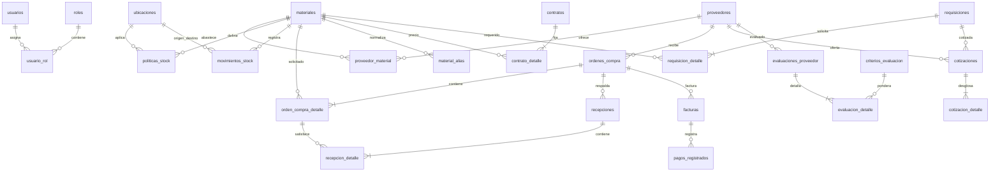

# DER — Del Valle Inventory AI (3FN)

**Relaciones N:M verificables:** materiales↔proveedores (`proveedor_material`), materiales↔ubicaciones (`politicas_stock`), usuarios↔roles (`usuario_rol`), órdenes↔materiales (`orden_compra_detalle`). Cada tabla puente tiene FK y clave compuesta/única. El saldo se deriva de `movimientos_stock`, no se duplica en inventario. Precios/condiciones históricos están separados de catálogos.
  requisiciones ||--|{ requisicion_detalle : solicita
  materiales ||--o{ requisicion_detalle : requerido
  requisiciones ||--o{ cotizaciones : cotizada
  proveedores ||--o{ cotizaciones : oferta
  cotizaciones ||--|{ cotizacion_detalle : desglosa
  proveedores ||--o{ evaluaciones_proveedor : evaluado
  criterios_evaluacion ||--o{ evaluacion_detalle : pondera
  evaluaciones_proveedor ||--|{ evaluacion_detalle : detalla
  ordenes_compra ||--o{ facturas : factura
  facturas ||--o{ pagos_registrados : registra
