# DER — Del Valle Inventory AI (3FN)

```mermaid
erDiagram
  usuarios ||--o{ usuario_rol : asigna
  roles ||--o{ usuario_rol : contiene
  materiales ||--o{ proveedor_material : abastece
  proveedores ||--o{ proveedor_material : ofrece
  materiales ||--o{ politicas_stock : define
  ubicaciones ||--o{ politicas_stock : aplica
  materiales ||--o{ movimientos_stock : registra
  ubicaciones ||--o{ movimientos_stock : origen_destino
  ordenes_compra ||--|{ orden_compra_detalle : contiene
  materiales ||--o{ orden_compra_detalle : solicitado
  proveedores ||--o{ ordenes_compra : recibe
  ordenes_compra ||--o{ recepciones : respalda
  recepciones ||--|{ recepcion_detalle : contiene
  orden_compra_detalle ||--o{ recepcion_detalle : satisface
  materiales ||--o{ material_alias : normaliza
  contratos ||--|{ contrato_detalle : fija
  materiales ||--o{ contrato_detalle : precio
  requisiciones ||--|{ requisicion_detalle : solicita
  materiales ||--o{ requisicion_detalle : requerido
  requisiciones ||--o{ cotizaciones : cotizada
  proveedores ||--o{ cotizaciones : oferta
  cotizaciones ||--|{ cotizacion_detalle : desglosa
  proveedores ||--o{ evaluaciones_proveedor : evaluado
  criterios_evaluacion ||--o{ evaluacion_detalle : pondera
  evaluaciones_proveedor ||--|{ evaluacion_detalle : detalla
  ordenes_compra ||--o{ facturas : factura
  facturas ||--o{ pagos_registrados : registra
  clientes ||--o| crm_client_profiles : perfil
  clientes ||--o{ crm_customer_contacts : contactos
  clientes ||--o{ crm_customer_consents : consentimiento
  clientes ||--o{ crm_customer_followups : seguimiento
  clientes ||--o{ crm_customer_order_links : vinculos
  customer_orders ||--o| crm_customer_order_links : cliente
  customer_orders ||--o{ customer_order_payment_events : movimientos
  customer_order_payment_events ||--o{ customer_order_payment_events : reembolso_de
  store_promotions ||--o{ customer_order_promotions : redenciones
  customer_orders ||--o| customer_order_promotions : aplica
  usuarios ||--o{ crm_customer_followups : crea
  usuarios ||--o{ customer_order_payment_events : registra
  usuarios ||--o{ store_promotions : crea
```

**Relaciones N:M verificables:** materiales↔proveedores (`proveedor_material`), materiales↔ubicaciones (`politicas_stock`), usuarios↔roles (`usuario_rol`), órdenes↔materiales (`orden_compra_detalle`). Cada tabla puente tiene FK y clave compuesta/única. El saldo se deriva de `movimientos_stock`, no se duplica en inventario. Precios/condiciones históricos están separados de catálogos.

El CRM extiende `clientes` sin duplicarlos: perfil uno a uno, contactos normalizados, historial de consentimientos y seguimientos. `crm_customer_order_links` vincula de forma auditable un pedido de tienda a un cliente; `customer_order_payment_events` conserva cobros y reembolsos como eventos separados. El reembolso referencia el cobro original, y el saldo se calcula desde el ledger.

Los códigos de promoción se guardan en `store_promotions`; `customer_order_promotions` conserva el código, subtotal y descuento aplicados al momento del pedido. Cada pedido admite como máximo una promoción y el uso se verifica bajo bloqueo para respetar el límite de redenciones.
